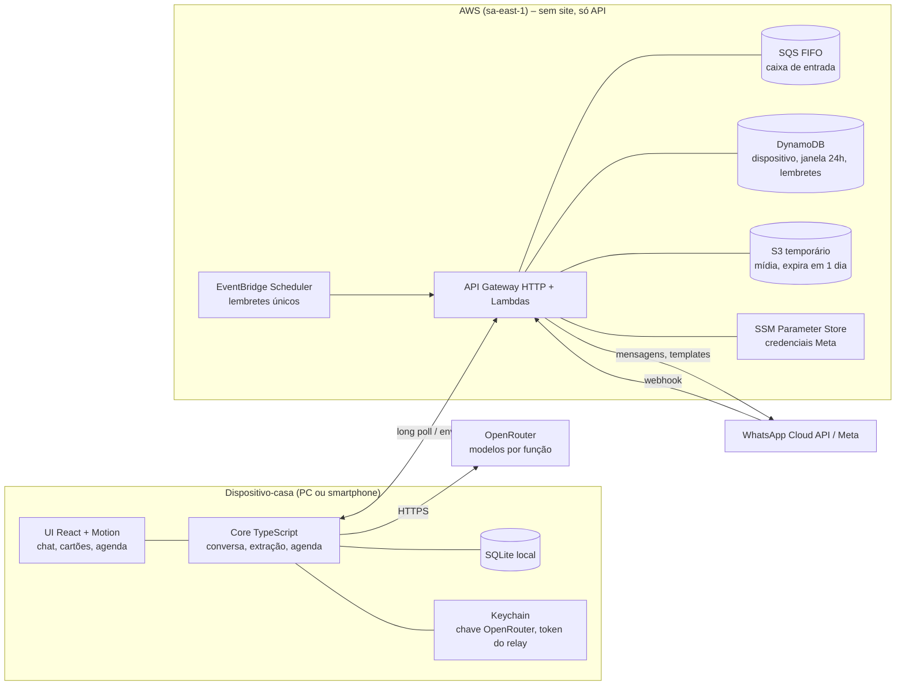
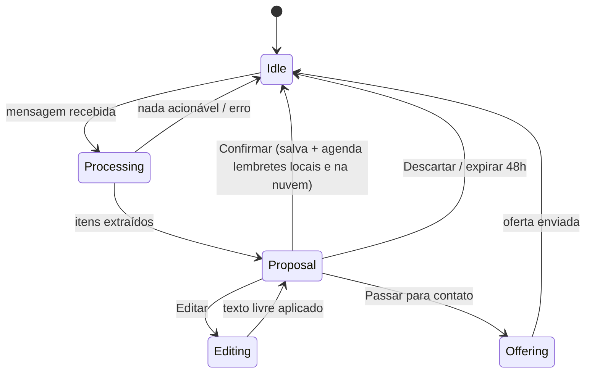

# Design: Pingo

## 1. Visão geral

Local-first com nuvem mínima. O app no dispositivo-casa é o cérebro (dados, regras, IA). A AWS é uma "caixa de correio" para o WhatsApp e um "despertador" para lembretes.



**Canal como interface.** O core fala com `Channel` (`sendText`, `sendCard`, `sendButtons`, `sendList`, `sendTemplate`, `fetchMedia`). Duas implementações: `SimulatorChannel` (dentro do app) e `RelayChannel` (WhatsApp via AWS). Regras de negócio não mudam entre elas.

**O que é "web" aqui:** apenas o endpoint HTTPS do webhook na AWS. Não existe site hospedado. A interface do app é uma WebView local empacotada.

## 2. Stack

| Camada | Escolha | Motivo |
|---|---|---|
| App | **Tauri 2** (Rust + WebView) | Um código para macOS/Windows/Linux e iOS/Android; binários pequenos; acesso a Keychain, notificações, bandeja e SQLite |
| UI | React + Vite + Tailwind + Motion | Animações de molas e layout compartilhado |
| Core | TypeScript puro em `packages/core` | Roda no app, em testes (Node) e, se preciso, em Lambda |
| Banco local | SQLite via `tauri-plugin-sql` + Drizzle (driver sqlite-proxy) | Arquivo único, fácil de fazer backup. *Validado na Fase 0: funciona; migrations sem transação (pool de conexões) e JOINs precisam de alias* |
| Segredos locais | Crate `keyring` 4 (Keychain/Credential Manager/Secret Service) via comandos Rust com lista de chaves permitidas | Chave OpenRouter e token do relay fora do banco. Mobile exigirá outro store (Fase 8) |
| IA | OpenRouter (API compatível com OpenAI) | Uma chave, vários modelos, fallback e roteamento por preço |
| Lembretes locais | `tauri-plugin-notification` + agendador no core | Aviso com o app aberto |
| IaC | **AWS CDK (TypeScript)** | Mesmo idioma do projeto; `cdk deploy` recria tudo |
| Relay | API Gateway HTTP API + Lambda (Node, ARM64) | Custo próximo de zero em uso pessoal |
| Fila | SQS FIFO + DLQ | Long polling nativo, entrega ordenada, retentativa |
| Estado do relay | DynamoDB sob demanda | Idempotência, janela de 24 h, dispositivo, agendamentos |
| Lembretes na nuvem | EventBridge Scheduler (schedules únicos `at()`) | Sem servidor ligado; auto-exclui após rodar |
| Mídia temporária | S3 com lifecycle de 1 dia + URLs pré-assinadas | Evita limite de 6 MB de payload da Lambda |
| Segredos AWS | SSM Parameter Store (SecureString) | Gratuito no nível padrão, mais barato que Secrets Manager |
| Região | `sa-east-1` (São Paulo) | Latência e dados no Brasil. Confirmar disponibilidade e preço dos serviços no deploy |

**Pré-requisitos já presentes na máquina:** Node, npm, Rust/cargo, AWS CLI v2 (com `~/.aws`), Docker. **A instalar:** pnpm, CLT do Tauri (nada extra no macOS além do Xcode CLT já ativo). **Só para iPhone:** Xcode completo e conta Apple Developer. **Só para Android:** Android Studio.

## 3. IA com OpenRouter

### Roteamento por função

Arquivo `packages/core/config/models.json` (editável, sem mexer em código). Cada função tem uma lista em ordem de preferência. **O fallback é feito pelo próprio app** (não pelo parâmetro `models` do OpenRouter), porque cada modelo precisa de parâmetros diferentes (esforço de raciocínio, por exemplo).

```json
{
  "roles": {
    "text":   [{ "id": "openai/gpt-oss-120b", "reasoning": "low" }, { "id": "google/gemini-2.5-flash-lite" }],
    "vision": [{ "id": "google/gemini-2.5-flash-lite" }, { "id": "openai/gpt-5-nano", "reasoning": "minimal" }],
    "pdf":    [{ "id": "openai/gpt-5-nano", "reasoning": "minimal" }, { "id": "google/gemini-2.5-flash-lite" }],
    "audio":  [{ "id": "google/gemini-2.5-flash-lite" }, { "id": "mistralai/voxtral-small-24b-2507" }]
  },
  "provider": { "sort": "price", "require_parameters": true, "data_collection": "deny", "allow_fallbacks": true },
  "limits": { "maxOutputTokens": 1500, "timeoutMs": 60000, "dailyUsd": 0.25, "monthlyUsd": 4 }
}
```

### Resultados medidos (conjunto de referência, 36 casos, 07/11/2026)

| Função | Modelo (esforço) | Acertos | Custo no conjunto | Tempo médio |
|---|---|---|---|---|
| Texto (28) | `openai/gpt-oss-120b` (low) | **28/28** | US$ 0,0017 | 3,0 s |
| Texto | `google/gemini-2.5-flash-lite` | 27/28 | US$ 0,0036 | 0,9 s |
| Texto | `deepseek/deepseek-v4.1-flash` | 28/28 | US$ 0,0042 | 5,7 s |
| Texto | `openai/gpt-5-nano` (minimal) | 18/28 | US$ 0,0031 | 2,0 s |
| Imagem (3) | `google/gemini-2.5-flash-lite` | 3/3 | US$ 0,0005 | 1,4 s |
| Imagem | `openai/gpt-5-nano` (minimal) | 2/3 | US$ 0,0004 | 2,9 s |
| PDF (2) | `openai/gpt-5-nano` (minimal) | 2/2 | US$ 0,0003 | 2,3 s |
| PDF | `google/gemini-2.5-flash-lite` | 1/2 (inventa itens num cardápio) | US$ 0,0006 | 2,6 s |
| Áudio (3, inclui Ogg/Opus do WhatsApp) | `google/gemini-2.5-flash-lite` | 3/3 | US$ 0,0006 | 1,7 s |
| Áudio | `mistralai/voxtral-small-24b-2507` | 3/3 | US$ 0,0029 | 1,8 s |

Notas:
- **Custo real por mensagem de texto:** cerca de US$ 0,00006 (uma extração completa).
- **Reasoning:** modelos de raciocínio gastam os tokens pensando e cortam a resposta se o esforço não for limitado. Por isso `reasoning` é por modelo; o Gemini não recebe o parâmetro.
- **Privacidade:** `data_collection: deny` elimina alguns provedores (ex.: `qwen/qwen3.7-flash` ficou sem endpoint). O app nunca relaxa isso sozinho.
- **Conjunto sintético:** a mídia (imagem, PDF, áudio) foi gerada por script. Antes do go-live, repetir a comparação com mensagens reais suas.
- **Excluídos de propósito:** variantes `:batch`, `:free` e aliases `~...-latest`.

### Regras de uso
- Saída sempre via JSON Schema estrito (`response_format`), validada com zod.
- Uma retentativa por modelo informando o erro; depois o próximo da lista; depois resposta amigável preservando a mensagem.
- `provider.data_collection: "deny"` sempre.
- `max_tokens` limitado e esforço de raciocínio baixo.
- Cada chamada grava modelo, tokens e custo (campo `usage.cost` do OpenRouter) na tabela `usage`.
- Teto diário e mensal em dólares (padrão no `models.json`, sobreposto por `settings.cap_daily_usd` e `cap_monthly_usd`).
- `pnpm --filter @pingo/core models:suggest` lista os mais baratos por modalidade (catálogo público, sem chave).
- `pnpm --filter @pingo/core compare` roda o conjunto de referência; aceita `--roles`, `--also "id@esforço"`, `--only`, `--verbose`.
- O cliente recebe `baseUrl`; trocar para um servidor local compatível (Ollama) é só configuração.

## 4. Modelo de dados (SQLite local)

```
settings(key PK, value)                       -- fuso, tetos, nome do dono, modelo preferido
owner(id=1, phone, name, tz, consent_at)
contacts(id, name, phone, opt_in_at NULL, status)   -- status: pending|active|blocked
messages(id, channel, direction, channel_msg_id UNIQUE, from_phone, type, text,
         media_path, transcript, created_at)
items(id, source_message_id, kind, title, summary,
      starts_at, ends_at, all_day, due_at, location,
      assignee_contact_id NULL, status, confidence, missing_fields JSON, evidence,
      created_at, updated_at)
      -- kind: task|event|deadline|authorization|payment|info
      -- status: proposed|confirmed|done|cancelled|discarded|expired
reminders(id, item_id, remind_at, status, delivered_via, cloud_schedule_id NULL, attempts)
      -- status: pending|sent|failed|cancelled ; delivered_via: local|cloud
assignments(id, item_id, contact_id, status, offered_at, answered_at)
conversation_state(id=1, state, payload JSON, expires_at)
usage(id, at, role, model, input_tokens, output_tokens, cost_usd)
```

Datas em UTC; conversão para o fuso do dono na apresentação.

## 5. Relay AWS (sem interface, só API)

### Rotas
| Rota | Quem chama | Função |
|---|---|---|
| `GET/POST /wa/webhook` | Meta | Verificação e recebimento; valida `X-Hub-Signature-256`; idempotência por id da mensagem; filtra pela lista de números permitidos; envia à fila; atualiza janela de 24 h; envia "Recebi!" se o app está offline |
| `POST /device/pair` | App (uma vez) | Troca código de pareamento por token de dispositivo (guardado como hash) |
| `GET /inbox?wait=20` | App | Long polling na fila SQS; devolve até N mensagens |
| `POST /inbox/ack` | App | Confirma e remove da fila |
| `POST /outbox` | App | Envia texto, botões, lista ou template; escolhe livre vs. template pela janela |
| `GET /media/{id}` | App | Baixa a mídia da Meta para S3 temporário e devolve link pré-assinado |
| `PUT /allowlist` | App | Atualiza números permitidos (dono + contatos com opt-in) |
| `PUT/DELETE /reminders/{id}` | App | Cria ou cancela schedule único no EventBridge |
| `DELETE /me` | App | Apaga tudo do dono na nuvem |

Lambda `send-reminder` é o alvo do Scheduler: monta a mensagem (ou template) e envia pelo WhatsApp.

### Dados na nuvem (DynamoDB, tabela única)
- `DEVICE`: hash do token, `last_seen`.
- `ALLOW#<phone>`: número permitido.
- `WINDOW#<phone>`: último recebimento (decide mensagem livre vs. template).
- `IDEMP#<wa_msg_id>`: TTL de 7 dias.
- `REMINDER#<id>`: texto já composto, destinatário, horário, referência do schedule; apagado após o envio.
- Texto das mensagens recebidas fica só na fila SQS (retenção máxima 4 dias, padrão do SQS configurável até 14) e some após o ack.

### Segurança
- Webhook público, mas só aceita payload com assinatura válida.
- Rotas do dispositivo exigem `Authorization: Bearer <token>`; token aleatório de 256 bits, comparado por hash.
- Limites de taxa no API Gateway; corpo máximo pequeno.
- Credenciais da Meta em SSM SecureString; permissões IAM mínimas por Lambda.
- Logs do CloudWatch com retenção de 14 dias e sem conteúdo de mensagens.
- Bucket S3 privado, bloqueio de acesso público, criptografia e lifecycle de 1 dia.

### Custo estimado
Lambda, API Gateway, SQS, DynamoDB, EventBridge Scheduler e S3 ficam em centavos ou dentro da camada gratuita em uso pessoal. O custo relevante é das conversas da Meta, não da AWS. Valores exatos devem ser conferidos nas páginas de preço no momento do deploy.

### Como o relay foi construído (Fase 5)

- **Código:** `apps/relay`. Os handlers só falam com portas (`Db`, `Queue`, `Secrets`, `Files`, `Scheduler`, `WhatsApp`), então rodam igual com a AWS (`src/aws`) e com versões em memória (`src/testing`). Contrato HTTP em `packages/shared/src/relay.ts`.
- **Lista de permitidos com papéis:** `ALLOW#<telefone>` guarda `owner` ou `contact`. Todos os cadastrados (inclusive contatos que ainda não aceitaram) podem responder; quem não está na lista é ignorado em silêncio. O app envia a lista inteira em `PUT /allowlist`.
- **Envio:** `POST /outbox` aceita `{to, message, fallback?}`. Dentro da janela de 24 h (com 5 min de folga) vai mensagem livre; fora, vai o `fallback` (modelo). Sem `fallback`, responde 409 `window_closed`. O relay só envia para números da lista.
- **Fila:** FIFO, um grupo por telefone, visibilidade de 120 s (o app precisa dar ack logo depois de gravar). Cinco recebimentos sem ack levam a mensagem à DLQ e disparam alarme.
- **App offline:** o app é considerado offline se o relay não o vê há 90 s (cada long poll renova).
- **Pareamento:** `pnpm relay:pair-code` grava o hash de um código de 20 caracteres, válido por 10 min e de uso único. Parear de novo revoga o token anterior.
- **Número do Brasil:** a Meta às vezes entrega celulares sem o 9º dígito; o relay sempre normaliza para a forma com o 9.
- **Tipos não suportados:** vídeo, figurinha, localização etc. chegam como evento com `unsupportedType`, para o app responder com educação (R1.1).
- **Segredos:** `/pingo/meta/{app-secret,access-token,phone-number-id,verify-token}` no SSM, criados só por `pnpm relay:set-secret`.
- **Limites de custo:** sem AWS Budgets por enquanto, porque a conta `publishing` tem outros recursos e um orçamento da conta inteira não serve. Alternativa: ativar a tag de custo `app` e criar um orçamento filtrado por ela.

### Limitações assumidas
- Long polling usa uma Lambda esperando até 20 s por chamada enquanto o app está aberto. Aceitável no MVP; se o custo ou a latência incomodarem, trocar por WebSocket API.
- Single-tenant: uma pilha por dono. Simples e isolado; multiusuário fica fora.

## 6. Dispositivo-casa e o que acontece quando ele está desligado

| Situação | Comportamento |
|---|---|
| App aberto ou na bandeja do PC | Mensagens chegam em segundos; proposta aparece no WhatsApp e no app |
| App fechado / PC desligado | Relay guarda a mensagem, responde "Recebi!" uma vez; ao abrir, o app processa a fila e envia as propostas |
| Lembrete com app fechado | Já está no EventBridge Scheduler; sai por WhatsApp no horário |
| Lembrete com app aberto | Notificação local; o lembrete da nuvem é cancelado ou ignorado por idempotência |
| Smartphone | iOS e Android suspendem apps em segundo plano. Funciona como PC "app aberto", mas sem fila em segundo plano. Por isso **desktop é o dispositivo-casa recomendado no MVP** e o celular entra na Fase 8 |

Backup: sem nuvem para dados, o app exporta o banco em arquivo (manual e agendado para uma pasta escolhida, ex.: iCloud Drive). Sincronização entre dispositivos fica fora do MVP.

## 7. Pipeline de extração

1. Montar o pedido: data/hora atual do dono, fuso e **calendário dos próximos 14 dias** (ancora "sexta", "amanhã"). O casamento de nomes com contatos é feito em código, depois.
2. Escolher a função pelo tipo de conteúdo: `text`, `vision`, `pdf` ou `audio`.
3. Chamar o OpenRouter com JSON Schema (todos os campos obrigatórios, aceitando `null`, por exigência do modo estrito). **Lembretes não vêm da IA:** o código aplica os padrões por tipo (R5.1), o que economiza tokens e é previsível:
   ```ts
   type Extraction = {
     actionable: boolean
     transcript?: string                // quando áudio
     items: Array<{
       kind: 'task'|'event'|'deadline'|'authorization'|'payment'|'info'
       title: string; summary: string
       start/end/due: string | null   // ISO local sem fuso
       all_day: boolean
       location, assignee_hint, summary: string | null
       missing: Array<'when'|'where'|'who'>
       confidence: number
       evidence: string
     }>
   }
   ```
4. Validar com zod; em falha, uma retentativa com o erro; depois a próxima alternativa da lista; depois resposta amigável preservando a mensagem.
5. **Prompt injection:** o conteúdo do usuário é dado. A chamada não tem ferramentas com efeito colateral; só devolve JSON. Quem salva é o código, após confirmação.
6. `evidence` alimenta "Conferir o original" com o trecho destacado.

**Conjunto de mensagens de referência** (`packages/core/fixtures`): 36 casos (28 texto, 3 imagem, 2 PDF, 3 áudio), sintéticos por enquanto, a trocar por mensagens reais anonimizadas (aviso escolar, convite, PDF, print, áudio, mensagem vaga, mensagem sem nada acionável) com a extração esperada. Um comando compara candidatos de modelo e mostra acertos, falhas e custo. É o que justifica trocar para um modelo mais barato.

## 8. Fluxo conversacional



- Vários itens: um cartão por item e "Confirmar todos".
- Roteador de intenção: regras para comandos exatos; modelo barato de texto para o resto.
- Primeira execução: onboarding com consentimento, cadastro do dono, chave do OpenRouter e (opcional) pareamento com o relay.

### Cartão "Entendi assim"
Ícone e cor do tipo, título, linhas Quando / Onde / Responsável / Lembrete, "não informado" quando faltar, ações Confirmar · Passar para · Editar · Descartar · Ver original. No WhatsApp: texto formatado + até 3 botões + lista para o restante.

### 8.1 Comandos e lembretes locais (Fase 3)

Comandos de texto exatos, sem IA: `hoje`, `amanhã`, `semana`, `pendentes`, `ajuda`, `contatos`, `adiciona <nome> <telefone>`, `remove contato <nome>`, `feito <texto>`, `cancelar <texto>`. Se o texto é curto e parece pergunta, uma chamada barata (`text`) decide se é consulta à agenda; senão segue para a extração.

Lembretes padrão (calculados pelo código; só horários futuros; itens `info` não têm):

| Tipo | Lembretes |
|---|---|
| Evento com hora | véspera 20:00 e 1 h antes |
| Evento de dia inteiro | véspera 20:00 e no dia 08:00 |
| Prazo, autorização, pagamento | 2 dias antes 09:00 e no dia 08:00 |
| Tarefa | véspera 09:00 e no dia 08:00 |

O agendador confere a cada 15 s. Lembrete de item concluído, cancelado ou já passado é cancelado sem avisar. Botões do lembrete: Feito, Adiar 1 h, Amanhã 9h.

Passar item para contato: depois de confirmar, se há contatos, aparece "Passar para…". A mensagem de oferta ao contato já serve de pedido de permissão (botões Aceito / Não posso). Só quem aceitou recebe lembretes do item. Números desconhecidos são ignorados em silêncio. No simulador, as mensagens ao contato aparecem no chat marcadas como simuladas, e os botões agem como o contato.

### 8.2 Privacidade e backup (Fase 4)

- **Consentimento:** aceite registrado em `owner.consent_at` e em `settings.consent_version`. Mudou o texto, suba `CONSENT_VERSION` e todos reaceitam.
- **Apagar:** `eraseAllData` esvazia todas as tabelas e preserva só tema, movimento reduzido e tetos de gasto. O app ainda remove a chave do cofre (opcional) e recarrega. Pelo chat, o botão de confirmação vale 2 minutos.
- **Backup:** JSON `{format:"pingo-backup", version:1, tables:{…}}`, todas as tabelas menos ajustes `backup_*` (específicos da máquina). Sem segredos. A validação usa os metadados das colunas do Drizzle (tipo, obrigatório) e confere as chaves estrangeiras antes de gravar.
- **Importar:** troca tudo. Sem transação confiável no driver, guarda uma cópia na memória e restaura se algo falhar.
- **Arquivos:** só em pastas que a pessoa escolheu na janela do sistema (escopo do plugin `fs`; `persisted-scope` lembra a pasta do backup automático). O app não tem acesso a outros caminhos.

## 9. Restrições do WhatsApp que moldam o produto

- A API oficial não entra em grupos: o dono encaminha a mensagem para o número do agente.
- Janela de 24 h: dentro dela, mensagem livre; fora, só template aprovado. Lembretes e ofertas precisam de templates (`lembrete_item`, `oferta_responsabilidade`, `boas_vindas`).
- Botões de resposta: máximo 3, título até 20 caracteres. Listas: até 10 linhas.
- Sem fontes, animações ou cards customizados no texto. Identidade visual no WhatsApp só via cartão como imagem (satori + resvg), opcional.

## 10. Design system (app e cartões)

**Personalidade:** despojado, caloroso, brincalhão.

**Paleta**
| Token | Claro | Escuro |
|---|---|---|
| `bg` | #FFF6E5 | #17120E |
| `surface` | #FFFFFF | #231C16 |
| `ink` | #2A1D13 | #FFF1DC |
| `primary` | #FF5A3C | #FF7A5C |
| `sun` | #FFC83D | #FFD361 |
| `mint` | #2BC4A0 | #43D9B5 |
| `sky` | #5B8CFF | #7FA3FF |
| `berry` | #B45CFF | #C985FF |

Cor por tipo: evento = sky, prazo = primary, tarefa = mint, autorização = sun, pagamento = berry, info = ink 60%.

**Tipografia (open source, OFL), empacotada no app e sem requisição externa:** Bricolage Grotesque (títulos, eixos de largura e peso animáveis), Fraunces itálico (destaques editoriais), Geist (interface), Geist Mono (horas, tabular).

**Ícones:** Phosphor, `duotone` por padrão e `fill` no estado ativo.

**Movimento (Motion)**
- Spring padrão `stiffness 380, damping 30`; saídas de 150 ms.
- Bolhas surgem com escala 0,92 → 1 vindo do lado do remetente.
- "Digitando" com três bolinhas em onda; o texto "Separando datas, tarefas e responsáveis…" troca o verbo a cada 1,2 s.
- Cartão: campos entram em cascata (60 ms); "não informado" pulsa discretamente.
- Confirmar: botão vira check com preenchimento radial; o cartão encolhe e voa até a aba Agenda (layout animation compartilhada); confete curto geométrico.
- Botões: `whileTap` 0,96; hover com ±1° de rotação; pílula de seleção que desliza entre opções (`layoutId`).
- Editar: campos editáveis no próprio cartão, sem modal.
- Telas: View Transitions API com fallback do Motion.
- Gestos: deslizar à direita confirma, à esquerda descarta, com vibração tátil no celular.
- `prefers-reduced-motion`: fades de 120 ms, sem confete.

**Componentes:** moldura de celular só em tela grande, barra de entrada (anexar imagem/PDF, gravar áudio com onda ao vivo, chips de atalho), bolhas, cartões, botões de resposta, lista, toast, aba Agenda (leitura, no app), painel de desenvolvedor.

**Acessibilidade:** contraste AA nos dois temas, foco visível, ARIA em botões de ícone, `aria-live` em mensagens novas.

## 11. Estrutura do repositório

```
apps/
  pingo/            # Tauri 2 + React (UI e shell nativo)
  relay/            # AWS CDK + Lambdas do relay
packages/
  core/             # domínio, extração, agenda, canais (interface), config/models.json, fixtures
  shared/           # tipos e contrato de API app↔relay
.kiro/              # specs e steering
```

## 12. Riscos

| Risco | Impacto | Mitigação |
|---|---|---|
| Modelo barato erra data | Compromisso perdido | Confirmação obrigatória, "não informado", evidência, conjunto de referência para escolher modelo |
| `data_collection: deny` reduz provedores | Modelo indisponível | App avisa; lista de alternativas; decisão do dono, nunca relaxar sozinho |
| Dados só no dispositivo | Perda por falha ou troca de aparelho | Backup exportável e agendado |
| App fechado = atraso nas propostas | Experiência pior | "Recebi!" imediato, bandeja + autostart no desktop, lembretes na nuvem |
| Celular suspende app | Fila não é processada em segundo plano | Desktop como dispositivo-casa no MVP |
| Driver Drizzle + plugin SQL do Tauri | Retrabalho no acesso a dados | Spike na Fase 0; plano B: Kysely ou SQL puro |
| Tauri mobile menos maduro que desktop | Atraso do app mobile | Mobile só na Fase 8, com possibilidade de usar Capacitor com o mesmo core |
| Aprovação de templates da Meta | Go-live atrasa | Submeter cedo |
| Verificação do negócio na Meta | Atraso | Iniciar em paralelo ao desenvolvimento |
| Regras e preços da Meta/AWS/OpenRouter mudam | Custo e limites | Conferir documentação no go-live; modelos em arquivo de configuração |

## 13. Decisões em aberto

1. ~~Perfil/região da AWS~~ Decidido: conta `publishing` (025843049355), `sa-east-1`, perfil SSO `publishing`.
2. Número de telefone dedicado ao WhatsApp Business.
3. Mascote ou ilustração própria (não reaproveitar o pato do vídeo).
4. Domínio próprio é opcional: o API Gateway fornece uma URL HTTPS; domínio só se quiser marca.
