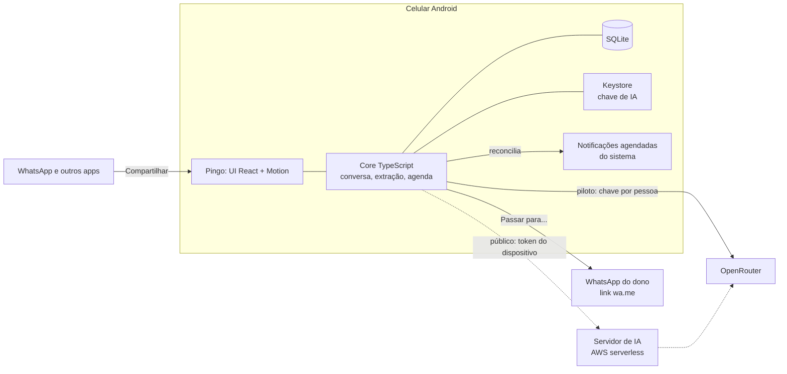
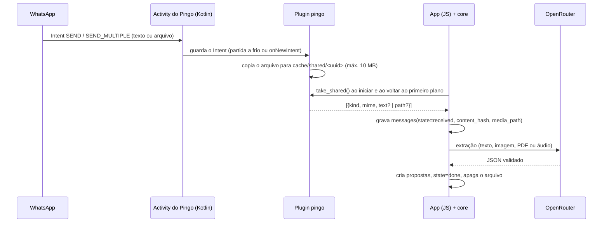
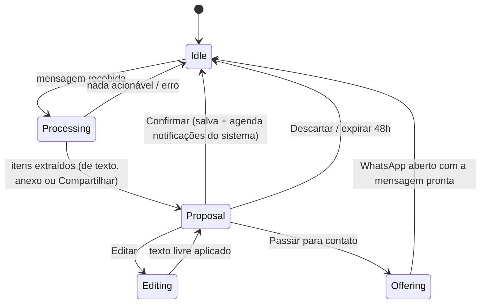

# Design: Pingo

> **Revisão de 23/11/2026.** O Pingo passou a ser um app de celular (Android primeiro) alimentado pelo menu **Compartilhar**, sem depender da Meta. O relay de WhatsApp na AWS foi pausado e a pilha, destruída (Apêndice B). A AWS só volta na fase pública, como um servidor de IA mínimo (Apêndice A), com custo mínimo como regra (R13).

## 1. Visão geral

Tudo o que importa vive no aparelho: dados, regras e lembretes. A IA é chamada pela internet (OpenRouter). Não existe servidor do Pingo no piloto.



**Canal como interface.** O core fala com `Channel`. Hoje há o canal do app (a conversa, que recebe também o que veio do Compartilhar) e, pausados, `RelayChannel` e `MultiChannel` (WhatsApp via relay). As regras de negócio não mudam entre eles.

**O que é "web" aqui:** nada. A interface é uma WebView local empacotada. No piloto não há endereço público; na fase pública há só uma API (servidor de IA) e uma página estática de política de privacidade exigida pela loja.

## 2. Stack

| Camada | Escolha | Motivo |
|---|---|---|
| App | **Tauri 2** (Rust + WebView): macOS para desenvolver, **Android** para usar; iOS depois | Um código para todos; binários pequenos |
| UI | React + Vite + Tailwind + Motion | Já pronta e aprovada; ajustes para tela de celular (§10) |
| Core | TypeScript puro em `packages/core` | Roda no app, em testes (Node) e, se preciso, em Lambda |
| Banco local | SQLite via `tauri-plugin-sql` + Drizzle (sqlite-proxy) | Arquivo único; funciona no desktop. **A validar no Android** (protótipo 1) |
| Segredos | Desktop: crate `keyring`. **Android: Keystore, via plugin próprio** | O `keyring` não cobre Android |
| Plugin nativo próprio | `packages/tauri-plugin-pingo` (Rust + Kotlin) | Receber o Compartilhar, cofre no Keystore, permissão de microfone, compartilhar arquivo, receptor de reinício (se preciso). Evita depender de plugins de terceiros para o que é central |
| IA | OpenRouter | Uma chave por pessoa no piloto; servidor de IA no público |
| Lembretes | Notificações agendadas do sistema + reconciliação (§6) | O Android não deixa o app rodar em segundo plano |
| Delegação | Link `wa.me` aberto pelo `tauri-plugin-opener` | Sem bot, sem Meta |
| Backup | JSON versionado + Compartilhar do sistema; Auto Backup do Android (a validar) | Sem pasta escolhida no celular |
| Servidor de IA (público) | AWS CDK (TypeScript), Lambda ARM + DynamoDB sob demanda, serverless puro | Custo mínimo (R13) |
| Região (servidor) | A decidir: `sa-east-1` (latência) ou `us-east-1` (preços menores) | Comparar custo e latência no Apêndice A |

**Pré-requisitos já presentes:** Node, pnpm, Rust (com os alvos Android instalados), AWS CLI. **A instalar:** Android Studio (traz o JDK 17+), SDK, NDK e platform-tools. Confira com `pnpm android:doctor`.

## 3. IA com OpenRouter

### Roteamento por função

Arquivo `packages/core/config/models.json` (editável, sem mexer em código). Cada função tem uma lista em ordem de preferência. **O fallback é feito pelo próprio app** (não pelo parâmetro `models` do OpenRouter), porque cada modelo precisa de parâmetros diferentes (esforço de raciocínio, por exemplo).

```json
{
  "roles": {
    "text":   [{ "id": "openai/gpt-oss-120b", "reasoning": "low" }, { "id": "google/gemini-2.5-flash-lite" }],
    "vision": [{ "id": "google/gemini-2.5-flash-lite" }, { "id": "openai/gpt-5-nano", "reasoning": "minimal" }],
    "pdf":    [{ "id": "openai/gpt-5-nano", "reasoning": "minimal" }, { "id": "google/gemini-2.5-flash-lite" }],
    "audio":  [{ "id": "google/gemini-2.5-flash-lite" }, { "id": "mistralai/voxtral-small-24b-2507" }]
  },
  "provider": { "sort": "price", "require_parameters": true, "data_collection": "deny", "allow_fallbacks": true },
  "limits": { "maxOutputTokens": 1500, "timeoutMs": 60000, "dailyUsd": 0.25, "monthlyUsd": 4 }
}
```

### Resultados medidos (conjunto de referência, 36 casos, 07/11/2026)

| Função | Modelo (esforço) | Acertos | Custo no conjunto | Tempo médio |
|---|---|---|---|---|
| Texto (28) | `openai/gpt-oss-120b` (low) | **28/28** | US$ 0,0017 | 3,0 s |
| Texto | `google/gemini-2.5-flash-lite` | 27/28 | US$ 0,0036 | 0,9 s |
| Texto | `deepseek/deepseek-v4.1-flash` | 28/28 | US$ 0,0042 | 5,7 s |
| Texto | `openai/gpt-5-nano` (minimal) | 18/28 | US$ 0,0031 | 2,0 s |
| Imagem (3) | `google/gemini-2.5-flash-lite` | 3/3 | US$ 0,0005 | 1,4 s |
| Imagem | `openai/gpt-5-nano` (minimal) | 2/3 | US$ 0,0004 | 2,9 s |
| PDF (2) | `openai/gpt-5-nano` (minimal) | 2/2 | US$ 0,0003 | 2,3 s |
| PDF | `google/gemini-2.5-flash-lite` | 1/2 (inventa itens num cardápio) | US$ 0,0006 | 2,6 s |
| Áudio (3, inclui Ogg/Opus do WhatsApp) | `google/gemini-2.5-flash-lite` | 3/3 | US$ 0,0006 | 1,7 s |
| Áudio | `mistralai/voxtral-small-24b-2507` | 3/3 | US$ 0,0029 | 1,8 s |

Notas:
- **Custo real por mensagem de texto:** cerca de US$ 0,00006 (uma extração completa).
- **Reasoning:** modelos de raciocínio gastam os tokens pensando e cortam a resposta se o esforço não for limitado. Por isso `reasoning` é por modelo; o Gemini não recebe o parâmetro.
- **Privacidade:** `data_collection: deny` elimina alguns provedores (ex.: `qwen/qwen3.7-flash` ficou sem endpoint). O app nunca relaxa isso sozinho.
- **Conjunto sintético:** a mídia (imagem, PDF, áudio) foi gerada por script. Antes do go-live, repetir a comparação com mensagens reais suas.
- **Excluídos de propósito:** variantes `:batch`, `:free` e aliases `~...-latest`.

### Regras de uso
- Saída sempre via JSON Schema estrito (`response_format`), validada com zod.
- Uma retentativa por modelo informando o erro; depois o próximo da lista; depois resposta amigável preservando a mensagem.
- `provider.data_collection: "deny"` sempre.
- `max_tokens` limitado e esforço de raciocínio baixo.
- Cada chamada grava modelo, tokens e custo (campo `usage.cost` do OpenRouter) na tabela `usage`.
- Teto diário e mensal em dólares (padrão no `models.json`, sobreposto por `settings.cap_daily_usd` e `cap_monthly_usd`).
- `pnpm --filter @pingo/core models:suggest` lista os mais baratos por modalidade (catálogo público, sem chave).
- `pnpm --filter @pingo/core compare` roda o conjunto de referência; aceita `--roles`, `--also "id@esforço"`, `--only`, `--verbose`.
- O cliente recebe `baseUrl`; trocar para um servidor local compatível (Ollama) é só configuração.

### Duas formas de chamar a IA (R10.8, R10.9)

| Modo | Quem usa | Como funciona |
|---|---|---|
| **Piloto** | Você e as pessoas convidadas | O app chama o OpenRouter direto com uma **chave própria da pessoa**, criada por você com **teto de gasto** (o OpenRouter limita crédito por chave) e entregue em particular. Fica no cofre do aparelho. Se alguém abusar ou sair, você revoga só aquela chave. Nada novo na AWS |
| **Público** | Qualquer pessoa | O app chama o **servidor de IA** do Pingo (Apêndice A) com um token do dispositivo. O servidor tem a chave, aplica cotas e restringe modelos. Como o cliente da IA já aceita `baseUrl`, o núcleo quase não muda |

## 4. Modelo de dados (SQLite local)

```
settings(key PK, value)                       -- fuso, tetos, consentimento, preferências
owner(id=1, phone NULL, name, tz, consent_at)  -- phone deixa de ser obrigatório
contacts(id, name, phone, status)             -- opt-in deixa de existir (o dono é quem envia)
messages(id, channel, direction, channel_msg_id UNIQUE, from_phone, type, text,
         media_path, transcript, created_at,
         state, attempts, content_hash)       -- NOVO: ver abaixo
items(id, source_message_id, kind, title, summary,
      starts_at, ends_at, all_day, due_at, location,
      assignee_contact_id NULL, status, confidence, missing_fields JSON, evidence,
      created_at, updated_at)
      -- kind: task|event|deadline|authorization|payment|info
      -- status: proposed|confirmed|done|cancelled|discarded|expired
reminders(id, item_id, remind_at, status, attempts,
          os_id INT NULL, body TEXT NULL, kind)   -- NOVO: ver abaixo
      -- status: pending|sent|failed|cancelled ; kind: item|nudge (cobrar contato)
assignments(id, item_id, contact_id, status, offered_at, answered_at, nudge_at NULL)
      -- status: offered (enviei pelo WhatsApp) | accepted (confirmou) | declined
conversation_state(id=1, state, payload JSON, expires_at)
usage(id, at, role, model, input_tokens, output_tokens, cost_usd)
chat_log(id, at, sender, payload JSON)
```

**Mudanças da revisão (cada uma vira migration):**
- `messages.state`: `received` → `processing` → `done` | `failed`. É o que garante R1.6 e R11.1: o conteúdo é gravado antes de qualquer processamento e, ao abrir o app, o que ficou em `received`/`processing` é reprocessado. O orquestrador deixa de descartar a mensagem repetida quando ela ainda não terminou.
- `messages.content_hash` (SHA-256 do texto ou dos bytes): aviso "parece que já recebi isso" (R1.5). O `channel_msg_id` passa a ser aleatório por compartilhamento.
- `messages.media_path`: a coluna já existe e passa a ser usada, só até o processamento terminar (R7.4).
- `reminders.os_id` (id da notificação no sistema) e `body` (texto composto na hora de agendar, R5.8). `delivered_via` e `cloud_schedule_id` deixam de ser usados.
- `reminders.kind = nudge`: lembrete para o dono cobrar um contato (R6.4).
- `contacts.opt_in_at` e o status `pending/active` perdem o sentido; simplificar.

Datas em UTC; conversão para o fuso do dono na apresentação.

## 5. Entrada pelo Compartilhar (Android)

**Caminho:** menu Compartilhar de qualquer app → Pingo → conversa com "organizando…" → cartão.



- **Filtros de Intent** no manifesto: `text/plain`, `image/*`, `application/pdf`, `audio/*`, para `SEND` e `SEND_MULTIPLE`. Notas de voz do WhatsApp chegam como `audio/ogg` (Opus).
- **`launchMode=singleTask`:** compartilhar com o app aberto reaproveita a instância (`onNewIntent`).
- **Entrega por comando, não por evento:** o JS pergunta (`take_shared`) quando a tela está pronta. O evento só avisa que há algo novo. Isso evita perder o Intent quando a WebView ainda não carregou (problema relatado nos plugins de terceiros).
- **Sem permissão de arquivos:** o compartilhamento dá acesso temporário ao conteúdo; o plugin copia na hora (R9.5).
- **Vários arquivos:** viram várias entradas, processadas em sequência (R9.4).
- **Texto compartilhado** vem sem remetente e sem hora. A data de referência é a do recebimento, o que está certo se você compartilha na hora.
- **Processar em primeiro plano.** A chamada de IA leva alguns segundos; se o sistema encerrar o app, o conteúdo está salvo como pendente e é reprocessado. Serviço em primeiro plano ou WorkManager ficam para depois, se o piloto mostrar necessidade.
- **Segurança:** o conteúdo é dado, nunca instrução (regra do pipeline). Arquivos são bytes opacos enviados ao modelo.

## 6. Lembretes pelo sistema

O ciclo de 15 s só funciona com o app aberto. No Android, cada lembrete passa a ser uma **notificação agendada no sistema**.

**Planejador (`ReminderPlanner`, novo, no core, com uma porta para a plataforma):**
1. Estado desejado = lembretes `pending` com `remind_at` no futuro.
2. Estado agendado = o que o sistema tem (`os_id`).
3. **Reconciliar:** cancela o que sobrou, agenda o que falta, atualiza o que mudou. Roda ao abrir o app, ao voltar ao primeiro plano e a cada confirmar, editar, concluir, cancelar ou adiar.
4. O texto (`body`) é composto no agendamento. O cálculo "hoje às 15:00 / amanhã" já recebe a data de referência como parâmetro; passa-se o horário do disparo.
5. **Hora aproximada** (R5.2): alarme inexato que atravessa o modo de economia (`setAndAllowWhileIdle`), sem permissão de alarme exato e sem justificar na Play.
6. **Ações** na notificação: Feito, Adiar 1 h, Amanhã 9h. Tocar abre o app e executa a ação (responder em segundo plano fica para depois).
7. **Reinício do aparelho:** notificações agendadas costumam se perder quando o Android reinicia. Duas saídas, decididas pelo protótipo 3: (a) o plugin oficial de notificações já reagenda; (b) receptor nativo `BOOT_COMPLETED` no plugin próprio, com uma cópia mínima dos alarmes (id, hora, título, texto) para reagendar sem abrir o app.
8. **App aberto:** o ciclo de 15 s continua, mas só posta a mensagem na conversa e marca `sent`; a notificação é do sistema (evita duplicata). Ao abrir depois de um período fechado, os lembretes vencidos aparecem na conversa e são marcados `sent`, sem nova notificação.
9. **Permissão** de notificações (Android 13+): pedida com explicação; sem ela, faixa visível "lembretes desligados" (R5.7). Fabricantes com economia agressiva de bateria podem atrasar alarmes; orientar a liberar o Pingo (a validar nos aparelhos do piloto).

## 7. Pipeline de extração

1. Montar o pedido: data/hora atual do dono, fuso e **calendário dos próximos 14 dias** (ancora "sexta", "amanhã"). O casamento de nomes com contatos é feito em código, depois.
2. Escolher a função pelo tipo de conteúdo: `text`, `vision`, `pdf` ou `audio`.
3. Chamar o OpenRouter com JSON Schema (todos os campos obrigatórios, aceitando `null`, por exigência do modo estrito). **Lembretes não vêm da IA:** o código aplica os padrões por tipo (R5.1), o que economiza tokens e é previsível:
   ```ts
   type Extraction = {
     actionable: boolean
     transcript?: string                // quando áudio
     items: Array<{
       kind: 'task'|'event'|'deadline'|'authorization'|'payment'|'info'
       title: string; summary: string
       start/end/due: string | null   // ISO local sem fuso
       all_day: boolean
       location, assignee_hint, summary: string | null
       missing: Array<'when'|'where'|'who'>
       confidence: number
       evidence: string
     }>
   }
   ```
4. Validar com zod; em falha, uma retentativa com o erro; depois a próxima alternativa da lista; depois resposta amigável preservando a mensagem.
5. **Prompt injection:** o conteúdo do usuário é dado. A chamada não tem ferramentas com efeito colateral; só devolve JSON. Quem salva é o código, após confirmação.
6. `evidence` alimenta "Conferir o original" com o trecho destacado.

**Conjunto de mensagens de referência** (`packages/core/fixtures`): 36 casos (28 texto, 3 imagem, 2 PDF, 3 áudio), sintéticos por enquanto, a trocar por mensagens reais anonimizadas (aviso escolar, convite, PDF, print, áudio, mensagem vaga, mensagem sem nada acionável) com a extração esperada. Um comando compara candidatos de modelo e mostra acertos, falhas e custo. É o que justifica trocar para um modelo mais barato.

## 8. Fluxo conversacional



- Vários itens: um cartão por item e "Confirmar todos".
- Roteador de intenção: regras para comandos exatos; modelo barato de texto para o resto.
- Primeira execução: consentimento, nome do dono e a chave do OpenRouter (colada; no piloto, a que você entregou a cada pessoa). O número de WhatsApp do dono deixa de ser pedido.

### Cartão "Entendi assim"
Ícone e cor do tipo, título, linhas Quando / Onde / Responsável / Lembrete, "não informado" quando faltar, ações Confirmar · Passar para · Editar · Descartar · Ver original. O mesmo cartão vira texto formatado (`renderCardText`) na mensagem ao contato (§8.3).

### 8.1 Comandos e lembretes locais (Fase 3)

Comandos de texto exatos, sem IA: `hoje`, `amanhã`, `semana`, `pendentes`, `ajuda`, `contatos`, `adiciona <nome> <telefone>`, `remove contato <nome>`, `feito <texto>`, `cancelar <texto>`. Se o texto é curto e parece pergunta, uma chamada barata (`text`) decide se é consulta à agenda; senão segue para a extração.

Lembretes padrão (calculados pelo código; só horários futuros; itens `info` não têm):

| Tipo | Lembretes |
|---|---|
| Evento com hora | véspera 20:00 e 1 h antes |
| Evento de dia inteiro | véspera 20:00 e no dia 08:00 |
| Prazo, autorização, pagamento | 2 dias antes 09:00 e no dia 08:00 |
| Tarefa | véspera 09:00 e no dia 08:00 |

Com o app aberto, um ciclo de 15 s posta o lembrete na conversa; com o app fechado, quem avisa é a notificação agendada (§6). Lembrete de item concluído, cancelado ou já passado é cancelado sem avisar. Ações do lembrete: Feito, Adiar 1 h, Amanhã 9h.

Passar item para contato: ver §8.3 (a oferta por botões "Aceito / Não posso" dependia do bot e foi substituída).

### 8.2 Privacidade e backup (Fase 4)

- **Consentimento:** aceite registrado em `owner.consent_at` e em `settings.consent_version`. Mudou o texto, suba `CONSENT_VERSION` e todos reaceitam.
- **Apagar:** `eraseAllData` esvazia todas as tabelas e preserva só tema, movimento reduzido e tetos de gasto. O app ainda remove a chave do cofre (opcional) e recarrega. Pelo chat, o botão de confirmação vale 2 minutos.
- **Backup:** JSON `{format:"pingo-backup", version:1, tables:{…}}`, todas as tabelas menos ajustes `backup_*` (específicos da máquina). Sem segredos. A validação usa os metadados das colunas do Drizzle (tipo, obrigatório) e confere as chaves estrangeiras antes de gravar.
- **Importar:** troca tudo. Sem transação confiável no driver, guarda uma cópia na memória e restaura se algo falhar.
- **Arquivos (desktop):** só em pastas que a pessoa escolheu na janela do sistema (escopo do plugin `fs`; `persisted-scope` lembra a pasta do backup automático). No Android, ver §8.4.

### 8.3 Delegação sem bot (R6)

O que o bot fazia ("Aceito / Não posso" pelo WhatsApp do contato) deixa de existir. O dono é quem envia.

1. Depois de confirmar um item, **Passar para…** lista os contatos.
2. O Pingo monta o texto (cartão formatado + "Responda *ok* para confirmar") e **abre `https://wa.me/<número>?text=<texto>`**. O Android entrega ao WhatsApp, que abre a conversa com a mensagem pronta. O dono toca em enviar.
3. A atribuição fica `offered` ("aguardando o Renato"), visível no item e na Agenda.
4. Quando o contato responde, o dono toca em **Confirmou** (ou **Recusou**) no item. `accepted` e `declined` passam a ser decisões do dono.
5. **Cobrança:** o Pingo cria um lembrete `nudge` para daqui a 24 h (ou para a véspera do item, o que vier primeiro), se ainda não houver confirmação. A notificação traz **Reenviar** e **Confirmou**.
6. Os lembretes do item vão **para o dono**, com o nome do responsável ("Renato: levar bolo"). O Pingo nunca escreve ao contato.

Mudanças no código: `offerToContact` deixa de enviar por canal e passa a devolver uma mensagem com um botão que abre o link (`ReplyButton` ganha `url` opcional, tratado pela interface); `onContactEvent`, os modelos da Meta e `lembrete_contato` saem do caminho do app; o comando `confirmou <nome>` é opcional.

### 8.4 Backup, exportar e apagar no Android

- **Exportar:** o JSON do backup é gravado num arquivo temporário e entregue à janela de Compartilhar do sistema (Drive, e-mail, WhatsApp). O plugin próprio expõe `share_file`.
- **Importar:** seletor de arquivo do sistema (o `plugin-dialog` abre arquivos no celular; validar).
- **Backup automático:** o Android pode copiar o banco do app para a conta Google da pessoa (Auto Backup). Exige configurar `allowBackup` e as regras de dados, **excluindo** o armazenamento das chaves (que de qualquer forma não voltaria num aparelho novo). A pessoa digita a chave de novo ao restaurar. **A validar** (protótipo 7).
- **Pasta de backup automático e salvar em pasta:** não se aplicam ao celular; a tela mostra só o que existe.
- **Apagar meus dados:** o que já existe serve; some a parte da nuvem. No fim, limpa também `cache/shared` e as chaves do Keystore.

## 9. Restrições do Android que moldam o produto

- **Sem segundo plano confiável.** O sistema pausa a WebView quando o app sai da tela e pode encerrar o processo. Por isso: entrada gravada como pendente (§5), lembretes agendados no sistema (§6) e nada de fila ouvindo o dia inteiro.
- **Modo de economia (Doze) e fabricantes agressivos** podem atrasar alarmes inexatos. Tolerância aceita: alguns minutos.
- **Permissões em tempo de execução:** notificações (Android 13+) e microfone. Nenhuma de arquivos nem de contatos no piloto.
- **Microfone na WebView:** declarar a permissão no manifesto não basta em apps Tauri; é preciso conceder a permissão do sistema e liberar o pedido da WebView. Protótipo 5.
- **Sem pasta arbitrária:** a escolha de pasta no Android devolve um endereço de provedor de documentos, não um caminho. Backup em pasta fica fora.
- **Botão voltar** e **gestos de navegação** fazem parte do layout (áreas seguras).
- **Google Play:** pacote AAB assinado, política de privacidade pública, formulário de segurança de dados, nível de API mínimo exigido (muda todo ano) e, para contas pessoais novas, teste fechado com 12 testadores por 14 dias seguidos.
- **Compartilhar entrega o texto, não o contexto** (remetente, hora). Não dá para saber quem escreveu.

## 10. Design system (app e cartões)

**Personalidade:** despojado, caloroso, brincalhão.

**Paleta**
| Token | Claro | Escuro |
|---|---|---|
| `bg` | #FFF6E5 | #17120E |
| `surface` | #FFFFFF | #231C16 |
| `ink` | #2A1D13 | #FFF1DC |
| `primary` | #FF5A3C | #FF7A5C |
| `sun` | #FFC83D | #FFD361 |
| `mint` | #2BC4A0 | #43D9B5 |
| `sky` | #5B8CFF | #7FA3FF |
| `berry` | #B45CFF | #C985FF |

Cor por tipo: evento = sky, prazo = primary, tarefa = mint, autorização = sun, pagamento = berry, info = ink 60%.

**Tipografia (open source, OFL), empacotada no app e sem requisição externa:** Bricolage Grotesque (títulos, eixos de largura e peso animáveis), Fraunces itálico (destaques editoriais), Geist (interface), Geist Mono (horas, tabular).

**Ícones:** Phosphor, `duotone` por padrão e `fill` no estado ativo.

**Movimento (Motion)**
- Spring padrão `stiffness 380, damping 30`; saídas de 150 ms.
- Bolhas surgem com escala 0,92 → 1 vindo do lado do remetente.
- "Digitando" com três bolinhas em onda; o texto "Separando datas, tarefas e responsáveis…" troca o verbo a cada 1,2 s.
- Cartão: campos entram em cascata (60 ms); "não informado" pulsa discretamente.
- Confirmar: botão vira check com preenchimento radial; o cartão encolhe e voa até a aba Agenda (layout animation compartilhada); confete curto geométrico.
- Botões: `whileTap` 0,96; hover com ±1° de rotação; pílula de seleção que desliza entre opções (`layoutId`).
- Editar: campos editáveis no próprio cartão, sem modal.
- Telas: View Transitions API com fallback do Motion.
- Gestos: deslizar à direita confirma, à esquerda descarta, com vibração tátil no celular.
- `prefers-reduced-motion`: fades de 120 ms, sem confete.

**Componentes:** moldura de celular só em tela grande, barra de entrada (anexar imagem/PDF, gravar áudio com onda ao vivo, chips de atalho), bolhas, cartões, botões de resposta, lista, toast, aba Agenda (leitura, no app), painel de desenvolvedor.

**Acessibilidade:** contraste AA nos dois temas, foco visível, ARIA em botões de ícone, `aria-live` em mensagens novas.

**Ajustes para celular (Fase 7):** a moldura de celular só aparece em tela grande, então no aparelho o app já ocupa a tela toda. Falta: áreas seguras (barra de status e de gestos), teclado empurrando o campo de texto em vez de cobri-lo, botão voltar do Android, alvos de toque de 48 dp ou mais, vibração tátil nos gestos, e a barra de abas acima da barra de gestos.

## 11. Estrutura do repositório

```
apps/
  pingo/                    # Tauri 2 + React (UI e shell nativo); desktop e Android
  relay/                    # PAUSADO: AWS CDK + Lambdas do relay de WhatsApp (pilha destruída)
packages/
  core/                     # domínio, extração, agenda, canais, config/models.json, fixtures
  shared/                   # tipos compartilhados
  tauri-plugin-pingo/       # NOVO: plugin nativo (Rust + Kotlin): Compartilhar, cofre, microfone, share_file, boot
scripts/
  android-doctor.sh         # confere o ambiente Android (pnpm android:doctor)
.kiro/                      # specs e steering
```

Atenção: o projeto Android gerado pelo Tauri (`src-tauri/gen/android`) **precisa ir para o git**, porque leva o manifesto com os filtros de Compartilhar. Hoje o `.gitignore` ignora `**/src-tauri/gen/`; ajustar para ignorar só `gen/schemas` e as saídas de compilação.

## 12. Riscos

| Risco | Impacto | Mitigação |
|---|---|---|
| Modelo barato erra data | Compromisso perdido | Confirmação obrigatória, "não informado", evidência, conjunto de referência |
| `data_collection: deny` reduz provedores | Modelo indisponível | App avisa; lista de alternativas; nunca relaxar sozinho |
| Compartilhar não entrega o arquivo com o app fechado | Fluxo principal quebra | Entrega por comando + protótipo 2 antes de construir |
| Lembretes não disparam após reinício, Doze ou economia de bateria | Perde-se a razão de existir do app | Reconciliação ao abrir, receptor de boot, protótipo 3, orientação ao usuário, tolerância de minutos |
| Microfone na WebView não funciona | Sem gravação de voz | Protótipo 5; plano B: gravação nativa pelo plugin |
| Banco ou cofre diferentes no Android | Retrabalho | Protótipos 1 e 4 antes da Fase 7 |
| App encerrado no meio da IA | Mensagem perdida | Estado `received` no banco e reprocessamento (R1.6, R11.1) |
| Dados só no aparelho | Perda por troca de celular | Exportar pelo Compartilhar e Auto Backup (validar) |
| Piloto: chave de IA com a pessoa | Vazamento ou abuso | Chave por pessoa com teto de gasto, revogável; Keystore |
| Público: abuso do servidor de IA | Custo descontrolado | Cota por usuário, atestado do aparelho, teto global com desligamento, alarmes (Apêndice A) |
| Custo da AWS cresce | Conta inesperada | Só serverless, sem recurso fixo, orçamento por etiqueta, destruir o que não usa (R13) |
| Regras da Play mudam (nível de API, testadores) | Atraso na publicação | Conferir na véspera; começar o teste fechado cedo |
| Tauri mobile menos maduro que desktop | Atraso | Protótipos primeiro; plugin próprio para o que é crítico; plano B: Capacitor com o mesmo core |
| Preços de AWS e OpenRouter mudam | Custo | Conferir no dia; modelos em arquivo de configuração |

## 13. Decisões

**Tomadas em 23/11/2026**
1. Android primeiro; iPhone depois. macOS continua como ambiente de desenvolvimento.
2. Entrada pelo Compartilhar; o bot de WhatsApp e a Meta ficam pausados.
3. Delegação manual: o dono envia pelo WhatsApp e marca "Confirmou"; o Pingo cobra (A + B).
4. Lembretes com hora aproximada; sem permissão de alarme exato.
5. Piloto por APK direto, com uma chave do OpenRouter por pessoa e teto de gasto.
6. Relay da AWS destruído (reimplantável com um comando). `CDKToolkit` fica (custo desprezível).
7. Público: gratuito com limite; assinatura depois.
8. Conta AWS: `publishing` (025843049355). Região do servidor de IA a decidir.

**Em aberto**
1. Identificador do app (`applicationId`): usar `br.com.pingo.app`? Não muda depois de publicar.
2. Nome "Pingo" disponível na Play? Mascote ou ilustração própria (não reaproveitar o pato do vídeo).
3. Região do servidor de IA (preço × latência) e se usa API Gateway HTTP ou URL de função.
4. Onde hospedar a política de privacidade (GitHub Pages resolve).
5. Limite do plano gratuito (extrações por mês) e como medir no piloto.
6. Conta de desenvolvedor da Play: pessoal (exige os 12 testadores) ou de organização.

## Apêndice A. Servidor de IA (fase pública)

**Objetivo:** permitir que qualquer pessoa use o Pingo sem criar conta no OpenRouter, com o menor custo possível na AWS. Só começa depois do piloto.

**Desenho**
- O cliente de IA do core já aceita `baseUrl` (R10.7). O servidor expõe uma rota compatível com o OpenRouter (`/chat/completions`), então o prompt e o pipeline continuam no app.
- `POST /v1/register`: o app envia o atestado do aparelho (Play Integrity) e recebe um token de dispositivo (guardado como hash). Sem contas de usuário nem Cognito no início.
- `POST /v1/chat/completions`: confere o token, aplica a cota, **substitui** o modelo pela lista permitida do servidor (o app não escolhe modelo caro), limita `max_tokens`, força `data_collection: deny`, repassa ao OpenRouter com a chave do Pingo e devolve o resultado com o custo.
- Cota por dispositivo por dia e por mês (contadores no DynamoDB com expiração) e **teto global diário**: ao atingir, o servidor responde "limite do dia" e para de repassar.
- `DELETE /v1/me`: apaga o registro do dispositivo (parte do "apagar meus dados").
- **Nunca registra conteúdo.** Logs só com id curto, modelo, tokens, custo e código de resposta.

**Regras de custo mínimo (R13)**

| Fazer | Não fazer |
|---|---|
| Lambda ARM, 256 MB, tempo limite curto | EC2, ECS/Fargate, RDS, ElastiCache |
| DynamoDB sob demanda, com TTL | Capacidade provisionada |
| API Gateway HTTP ou URL de função (comparar) | NAT Gateway, balanceador, VPC sem necessidade |
| Logs de 7 a 14 dias | Logs sem expiração |
| Orçamento mensal por etiqueta `app=pingo` + alarmes de falha e de volume | Alarmes demais (os primeiros são gratuitos) |
| Desligar sozinho ao bater o teto diário | Confiar só em alerta por e-mail |
| `cdk destroy` do que não estiver em uso | Deixar ambiente de teste ligado |

**A medir no piloto:** custo por extração (texto, imagem, PDF, áudio), tamanho médio e extrações por pessoa por mês. Só então fixar o limite do plano gratuito. O custo da IA tende a dominar o da AWS; medir os dois.

**Reuso do relay:** CDK, token por dispositivo guardado como hash, alarmes, limitação de taxa e o roteiro de teste (`test` e `smoke`) aproveitam o que já existe em `apps/relay`.

## Apêndice B. Canal WhatsApp via relay (pausado)

**Estado:** o código está completo e testado, mas **a pilha `PingoRelay` foi destruída em 23/11/2026** e a Meta nunca foi ligada. Nada roda na AWS além do preparo do CDK (`CDKToolkit`).

**O que existe:** `apps/relay` (webhook assinado, fila FIFO, rotas do dispositivo, lembretes no EventBridge Scheduler, alarmes, scripts `test`, `test:channel`, `smoke`, `set-secret`, `pair-code`); `RelayChannel`, `MultiChannel`, `toWire` e a seção "WhatsApp" de Ajustes no app (ver `apps/relay/README.md`).

**Para retomar:** `pnpm relay:deploy`, depois `relay:set-secret` para as credenciais da Meta e `relay:pair-code` para parear. Conta Meta Business, número dedicado e os 4 modelos de mensagem continuam pendentes (`go-live.md`, apêndice).

### B.1 Desenho do relay (como foi construído)

### Rotas
| Rota | Quem chama | Função |
|---|---|---|
| `GET/POST /wa/webhook` | Meta | Verificação e recebimento; valida `X-Hub-Signature-256`; idempotência por id da mensagem; filtra pela lista de números permitidos; envia à fila; atualiza janela de 24 h; envia "Recebi!" se o app está offline |
| `POST /device/pair` | App (uma vez) | Troca código de pareamento por token de dispositivo (guardado como hash) |
| `GET /inbox?wait=20` | App | Long polling na fila SQS; devolve até N mensagens |
| `POST /inbox/ack` | App | Confirma e remove da fila |
| `POST /outbox` | App | Envia texto, botões, lista ou template; escolhe livre vs. template pela janela |
| `GET /media/{id}` | App | Baixa a mídia da Meta para S3 temporário e devolve link pré-assinado |
| `PUT /allowlist` | App | Atualiza números permitidos (dono + contatos com opt-in) |
| `PUT/DELETE /reminders/{id}` | App | Cria ou cancela schedule único no EventBridge |
| `DELETE /me` | App | Apaga tudo do dono na nuvem |

Lambda `send-reminder` é o alvo do Scheduler: monta a mensagem (ou template) e envia pelo WhatsApp.

### Dados na nuvem (DynamoDB, tabela única)
- `DEVICE`: hash do token, `last_seen`.
- `ALLOW#<phone>`: número permitido.
- `WINDOW#<phone>`: último recebimento (decide mensagem livre vs. template).
- `IDEMP#<wa_msg_id>`: TTL de 7 dias.
- `REMINDER#<id>`: texto já composto, destinatário, horário, referência do schedule; apagado após o envio.
- Texto das mensagens recebidas fica só na fila SQS (retenção máxima 4 dias, padrão do SQS configurável até 14) e some após o ack.

### Segurança
- Webhook público, mas só aceita payload com assinatura válida.
- Rotas do dispositivo exigem `Authorization: Bearer <token>`; token aleatório de 256 bits, comparado por hash.
- Limites de taxa no API Gateway; corpo máximo pequeno.
- Credenciais da Meta em SSM SecureString; permissões IAM mínimas por Lambda.
- Logs do CloudWatch com retenção de 14 dias e sem conteúdo de mensagens.
- Bucket S3 privado, bloqueio de acesso público, criptografia e lifecycle de 1 dia.

### Custo estimado
Lambda, API Gateway, SQS, DynamoDB, EventBridge Scheduler e S3 ficam em centavos ou dentro da camada gratuita em uso pessoal. O custo relevante é das conversas da Meta, não da AWS. Valores exatos devem ser conferidos nas páginas de preço no momento do deploy.

### Como o relay foi construído (Fase 5)

- **Código:** `apps/relay`. Os handlers só falam com portas (`Db`, `Queue`, `Secrets`, `Files`, `Scheduler`, `WhatsApp`), então rodam igual com a AWS (`src/aws`) e com versões em memória (`src/testing`). Contrato HTTP em `packages/shared/src/relay.ts`.
- **Lista de permitidos com papéis:** `ALLOW#<telefone>` guarda `owner` ou `contact`. Todos os cadastrados (inclusive contatos que ainda não aceitaram) podem responder; quem não está na lista é ignorado em silêncio. O app envia a lista inteira em `PUT /allowlist`.
- **Envio:** `POST /outbox` aceita `{to, message, fallback?}`. Dentro da janela de 24 h (com 5 min de folga) vai mensagem livre; fora, vai o `fallback` (modelo). Sem `fallback`, responde 409 `window_closed`. O relay só envia para números da lista.
- **Fila:** FIFO, um grupo por telefone, visibilidade de 120 s (o app precisa dar ack logo depois de gravar). Cinco recebimentos sem ack levam a mensagem à DLQ e disparam alarme.
- **App offline:** o app é considerado offline se o relay não o vê há 90 s (cada long poll renova).
- **Pareamento:** `pnpm relay:pair-code` grava o hash de um código de 20 caracteres, válido por 10 min e de uso único. Parear de novo revoga o token anterior.
- **Número do Brasil:** a Meta às vezes entrega celulares sem o 9º dígito; o relay sempre normaliza para a forma com o 9.
- **Tipos não suportados:** vídeo, figurinha, localização etc. chegam como evento com `unsupportedType`, para o app responder com educação (R1.1).
- **Segredos:** `/pingo/meta/{app-secret,access-token,phone-number-id,verify-token}` no SSM, criados só por `pnpm relay:set-secret`.
- **Limites de custo:** sem AWS Budgets por enquanto, porque a conta `publishing` tem outros recursos e um orçamento da conta inteira não serve. Alternativa: ativar a tag de custo `app` e criar um orçamento filtrado por ela.

### Limitações assumidas
- Long polling usa uma Lambda esperando até 20 s por chamada enquanto o app está aberto. Aceitável no MVP; se o custo ou a latência incomodarem, trocar por WebSocket API.
- Single-tenant: uma pilha por dono. Simples e isolado; multiusuário fica fora.

### B.2 Dispositivo-casa e o que acontece quando ele está desligado

| Situação | Comportamento |
|---|---|
| App aberto ou na bandeja do PC | Mensagens chegam em segundos; proposta aparece no WhatsApp e no app |
| App fechado / PC desligado | Relay guarda a mensagem, responde "Recebi!" uma vez; ao abrir, o app processa a fila e envia as propostas |
| Lembrete com app fechado | Já está no EventBridge Scheduler; sai por WhatsApp no horário |
| Lembrete com app aberto | Notificação local; o lembrete da nuvem é cancelado ou ignorado por idempotência |
| Smartphone | iOS e Android suspendem apps em segundo plano. Funciona como PC "app aberto", mas sem fila em segundo plano. Por isso **desktop é o dispositivo-casa recomendado no MVP** e o celular entra na Fase 8 |

Backup: sem nuvem para dados, o app exporta o banco em arquivo (manual e agendado para uma pasta escolhida, ex.: iCloud Drive). Sincronização entre dispositivos fica fora do MVP.

### B.3 Restrições do WhatsApp

- A API oficial não entra em grupos: o dono encaminha a mensagem para o número do agente.
- Janela de 24 h: dentro dela, mensagem livre; fora, só template aprovado. Lembretes e ofertas precisam de templates (`lembrete_item`, `oferta_responsabilidade`, `boas_vindas`).
- Botões de resposta: máximo 3, título até 20 caracteres. Listas: até 10 linhas.
- Sem fontes, animações ou cards customizados no texto. Identidade visual no WhatsApp só via cartão como imagem (satori + resvg), opcional.
